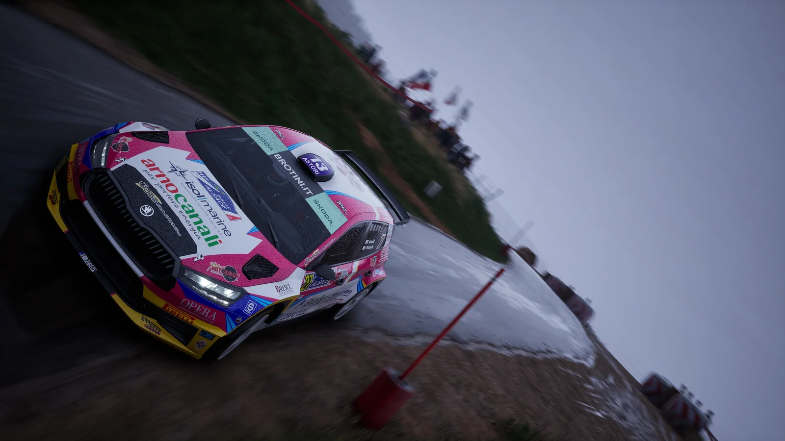

Chcielibyśmy zaprosić Was na otwarte testy **ACR Club** - aplikacji, która pozwala rywalizować w Assetto Corsa Rally na wzór klubów znanych z EA Sports WRC. Wszystko, czego potrzebujecie, znajdziecie w jednym miejscu: na stronie [acr.projectsimracing.pl](https://acr.projectsimracing.pl/).

## Czym jest ACR Club

Aplikacja działa w tle podczas jazdy w trybie **Rally Weekend**. W czasie rzeczywistym przesyła czasy wybranych odcinków specjalnych na nasz serwer, a wyniki trafiają do klasyfikacji na stronie klubu po weryfikacji.

Tak jak w klubach WRC, każdy odcinek ma **jedną próbę**. Wyjście z gry albo restart w trakcie OS-u unieważnia wynik.

## Jak wystartować

1. Pobierzcie i zainstalujcie launcher ze strony [acr.projectsimracing.pl](https://acr.projectsimracing.pl/).
2. Zalogujcie się na stronie kontem Steam.
3. Wybierzcie trwający rajd i kliknijcie **RUN Rally** - gra uruchomi się sama.
4. W grze wybierzcie tryb **Rally Weekend**.
5. Wybierzcie samochód i opony - i startujecie.

Na stronie klubu jest cały hub: logowanie, pobieranie launchera, informacje o rajdach i szczegółowy poradnik startu. Launcher działa na Windowsie.

## Kalendarz testów

Pierwsze testy składają się z trzech krótkich rajdów. Każdy trwa tydzień, z wyjątkiem Grecji, która potrwa 8 dni. We wszystkich jeździmy samochodami klasy Rally2/R5.

| # | Rajd | Odcinki | Termin |
|---|---|---|---|
| 1 | Grecja | 4 OS | 17-25 października |
| 2 | Walia | 4 OS | 26 października - 1 listopada |
| 3 | Monte-Carlo | 3 OS | 2-8 listopada |

Testowo, na dwóch pierwszych rajdach, **wychodzenie między odcinkami jest dozwolone**. Jeśli po odcinku nie ma serwisu, można wyjść z gry po wczytaniu kolejnego OS-u, zanim zacznie się odliczanie, i kontynuować po ponownym uruchomieniu gry lub aplikacji. Można też wyjść na serwisie. **Monte-Carlo trzeba będzie przejechać „na raz”.**

## To jeszcze nie sezon

Testy nie są sezonem. Na stronie klubu prowadzona będzie klasyfikacja, ale nie ma regulaminu - na razie chcemy przede wszystkim zebrać Wasze opinie i sprawdzić, jakie błędy systemu mogą pojawić się w trakcie jazdy. Każda uwaga i każdy zgłoszony problem pomogą przygotować pełnoprawny sezon.

## ACR Daily

ACR Club powstał na bazie **ACR Daily**, stworzonego przez indycheck. To platforma oferująca codzienne wyzwania, ale także ligi. Można tam wyzwać innych graczy na pojedynki i tworzyć własne sezony. Są też sezony oficjalne, osiągnięcia, własny overlay w grze i system kredytów.

Warto zaglądać tam codziennie, bo każdego dnia losują się dwa nowe odcinki do rywalizacji. ACR Daily również wymaga launchera, z którego wchodzi się do gry - w przeciwieństwie do klubu, w którym startujecie ze strony.

Więcej na [acrdaily.com](https://acrdaily.com/).
