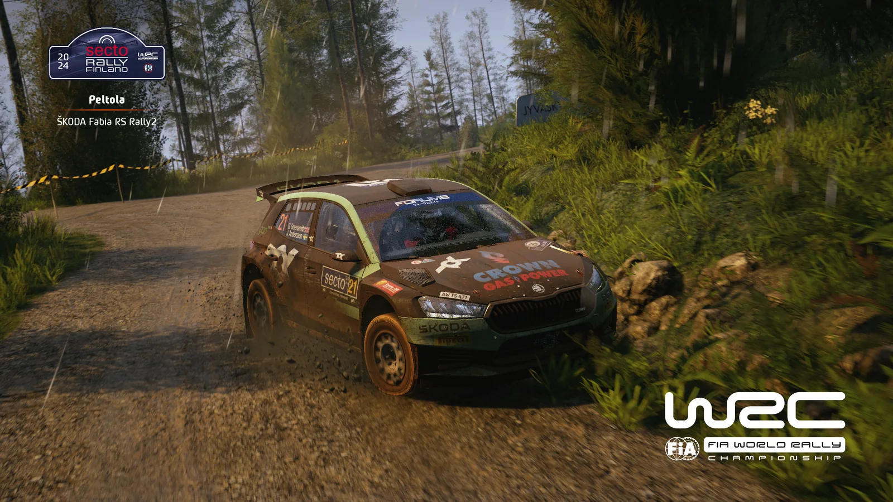
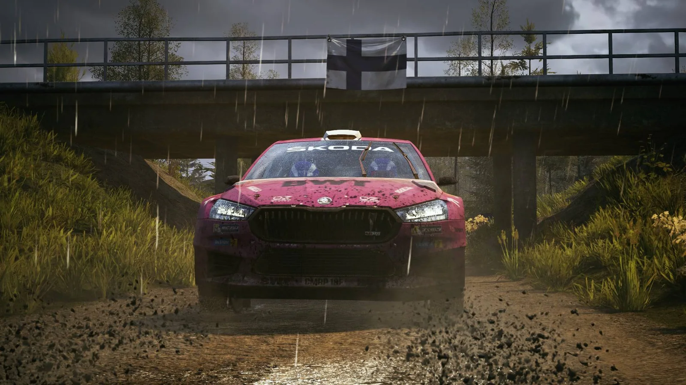

## Powrót do wysokich prędkości

Wysokie prędkości, szybkie szutrowe oesy w lasach Europy Północnej, ale także skarpy, ciasne nawroty i wysokie podjazdy Akropolu - z tym wszystkim mierzyli się do tej pory zawodnicy ostatniego sezonu ligi EA Sports WRC, mimo że mają za sobą dopiero dwie jego rundy. Niezależnie od charakterystyki rajdów, oba z nich zdominował Michał Król.

Po wymagającym, najwolniejszym w sezonie Rajdzie Grecji przyszedł czas, by znowu podnieść tempo. Trzecią rundą sezonu był Rajd Finlandii, który słynie przede wszystkim z długich hop i szerokich leśnych dróg. Jak wiadomo, jest to jeden z najszybszych rajdów na świecie, więc liczyła się przede wszystkim odwaga. Kierowcy musieli znaleźć jej jeszcze więcej z uwagi na to, że cały rajd był rozegrany na mokrej nawierzchni, a na niektórych oesach zawodnikom towarzyszyły lekkie opady deszczu.

## Podium: Katana, Norbert, AdamRacer

Wspomniany Katana, czyli Michał Król, pokazał już, że nie ma sobie równych w pierwszej części sezonu, niezależnie od tego, czy podróżuje po szybkich, czy wolnych drogach. Przystąpił do Rajdu Finlandii z kompletem możliwych do zdobycia punktów i, jak można było się spodziewać, wygrał fińską rundę, ponownie zdobywając maksymalne 55 punktów. Michał „odjeżdża” tym samym reszcie stawki i jego przewaga nad drugim zawodnikiem w najwyższej klasyfikacji PSR1 wynosi już 15 pkt.

Jest nim Norbert, który taką samą, drugą pozycję zajął w trzeciej rundzie sezonu. Norbert powtórzył tym samym swój wynik z Rajdu Łotwy i potwierdza kapitalną formę, nie schodząc z podium od samego początku sezonu. Warto wspomnieć, że doświadczony Michał Król obstawiał, że Norbert może go pokonać, i wiele się nie pomylił, bowiem strata Norberta do triumfatora wyniosła tylko 7 sekund.

Po siódmym miejscu na Łotwie AdamRacer ustabilizował swoją formę na topowym poziomie. Po drugim miejscu w Grecji nie miał chęci schodzić z podium i to on uzupełnił skład „pudła” skandynawskiej rundy. Co prawda jego strata była nieco większa niż pojedyncze sekundy, ale taka jazda pozwala mu na utrzymanie miejsca na podium klasyfikacji PSR1 z dużą, 17-punktową przewagą nad czwartym zawodnikiem.

## Od czwartego do dziesiątego miejsca

Do topowej dyspozycji powraca także Letar, który czwartym miejscem w Finlandii powiększa swoją przewagę jako lider klasyfikacji Rookie. Dwie sekundy za nim na metę wpadł piąty Thoma. Pozwala mu to na zajęcie czwartej pozycji w „generalce” najwyższej kategorii, ze sporymi szansami na jej utrzymanie w nadchodzących rajdach.

Z rundy na rundę swoją dyspozycję poprawia szósty w Finlandii daro, dla którego jest to naturalnie najlepszy wynik w sezonie. Bardzo dobrze na tle poprzednich występów odnalazł się w Finlandii DAF_TORO_ROSSO, który swoim siódmym miejscem pierwszy raz zanotował wynik w czołowej dziesiątce. Tak samo sprawa wygląda w przypadku Cheetacka, którego od DAF-a dzieliła zaledwie jedna dziesiąta sekundy! Jego ósme miejsce jest najlepszym występem w sezonie i pierwszym ukończonym w TOP10.

Po dwóch jednopunktowych wynikach na otwarcie sezonu świetnie w Skandynawii spisał się JacekR, który zajął dziewiątą pozycję. Topową dziesiątkę uzupełnił DEVMAR, który po raz pierwszy w sezonie się w niej zmieścił.

| Miejsce | Kierowca |
|---|---|
| 1. | Michał „Katana” Król |
| 2. | Norbert |
| 3. | AdamRacer |
| 4. | Letar |
| 5. | Thoma |
| 6. | daro |
| 7. | DAF_TORO_ROSSO |
| 8. | Cheetack |
| 9. | JacekR |
| 10. | DEVMAR |

## Druga dziesiątka

Po raz pierwszy w sezonie w czołowej dziesiątce nie znalazł się za to jedenasty Kori, któremu do tego wyczynu zabrakło tylko dwóch sekund. Także MaxxeR zanotował na mokrych szutrach najsłabszy wynik w sezonie, kończąc rajd na dwunastym miejscu. Patrickyo poprawia się z biegiem sezonu, a trzynasta pozycja w Finlandii to jego najlepszy jak dotąd występ. Równą formę na miejsca w połowie drugiej dziesiątki utrzymuje Olex, tym razem czternasty. Warto wspomnieć, że Olex pozostaje w grze o podium klasyfikacji PSR2, gdzie zajmuje obecnie czwartą lokatę.

Rajd Finlandii przyciągnął do rywalizacji także kilku debiutantów. Jednym z nich był Kasztanahh, który zajął 15. miejsce i z miejsca „wskoczył” do czołowej „dychy” klasyfikacji Rookie. Do formy wrócił jeden z niewielu kierowców Hyundaia, Switch, który zajął w trzeciej rundzie 16. pozycję. Po jednocyfrowych wynikach punktowych bardzo dobrze w Skandynawii zaprezentował się Pabcio, siedemnasty na mecie.

Tomasz Ciborek cały czas poszukuje dyspozycji, którą był w stanie pokazywać w poprzednich sezonach, i po czwartym miejscu w Grecji tutaj musi się zadowolić 18. pozycją. Nieco słabiej niż poprzednio, ale nieźle w imprezie nazywanej kiedyś Rajdem Tysiąca Jezior zaprezentował się 19. Wolf. Topową dwudziestkę uzupełnił PawełK.

## Klasyfikacja zespołowa

Powrót do szybkiej jazdy namieszał nie tylko w wynikach najlepszej indywidualnej dwudziestki, ale także w miejscach poszczególnych zespołów.

| Miejsce | Zespół | Kierowcy (miejsce w rajdzie) |
|---|---|---|
| 1. | RacersPL | AdamRacer (3.), Thoma (5.), MaxxeR (12.) |
| 2. | SRC | Norbert (2.), daro (6.), Crift (24.) |
| 3. | Maczeta Racing | Letar (4.), Cheetack (8.), Godzio (42.) |
| 4. | Purple Sector | DAF_TORO_ROSSO (7.), DEVMAR (10.), ValtteriB (26.) |
| 5. | AdBlue Rally Team | Wolf (19.), Kaczy (21.), Shieryff (30.) |
| 6. | Almost Pro Rally Team | PawełK (20.), now_ikk (25.), RedDevil (31.) |
| 7. | MEGA WACKI | JacekR (9.) |
| 8. | ODCINA | Switch (16.), Liscypis, Xalion (46.) |
| 9. | Lewy-3-Drzewo | Patrickyo (13.) |
| 10. | Automobilklub Chełmski | Patryk Sahadel (22.), old_max (39.) |
| 11. | Instinct Motorsport | pawlakki (27.), artur (34.) |

Kolejna runda oznacza kolejny akt walki pomiędzy dwoma najlepszymi w tym sezonie ekipami. RacersPL oraz SRC wymienili się zwycięstwami w poprzednich dwóch rundach, ale to RacersPL po raz drugi w sezonie zwyciężyło, zdobywając w Finlandii 106 pkt. Naturalnie najszybszym z zawodników był AdamRacer, który zdobył 45 pkt. Niewiele mniej, bo 39, do zespołowego dorobku dołożył Thoma. MaxxeR za swoje 12. miejsce wzmocnił dorobek punktowy o kolejne 24 pkt. RacersPL oddala się tym samym od swoich głównych rywali, mając nad nimi już 39 pkt przewagi.

Główni konkurenci liderów zespołowej „generalki”, a więc zespół SRC, zajęli w Finlandii drugą pozycję. Walka od drugiej rundy jest wyrównana, ponieważ różnica między zwycięzcami a SRC wyniosła tylko 9 pkt. Najwięcej, bo aż 50 punktów, zdobył drugi na mecie Norbert. Walkę o zwycięstwo umożliwił także wynik daro, który zdobył 36 pkt. Crift, który wrócił do regularnych startów, wzmocnił konto drużyny o 12 pkt za 24. lokatę. SRC zajmuje dość pewne drugie miejsce w klasyfikacji generalnej.

Po raz kolejny na trzecim miejscu zameldowali się zawodnicy teamu Maczeta Racing. Krakowiacy umacniają się tym samym na ostatnim stopniu podium klasyfikacji generalnej, z bardzo spokojną przewagą nad czwartym zespołem. Na 73-punktowy wynik pozwoliły rezultaty Letara, który zdobył 39 pkt, Cheetacka, który ukończył rajd z 31 pkt dorobku, oraz Godzia, który tym razem finiszował na 42. pozycji i za ukończenie został nagrodzony punktem.

Czwarte miejsce po raz drugi z rzędu należało do Purple Sector. „Purpurowym” zabrakło tym razem do podium tylko trzech punktów. Na powtórkę najlepszego wyniku w sezonie pozwoliły rezultaty DAF-a oraz DEVMAR-a w TOP10 - pierwszy z nich uzyskał 33, a drugi 27 pkt. W punktach zmieścił się także Valtteri, który za 26. pozycję uzyskał 10 „oczek”. Zespół zajmuje czwarte miejsce w „generalce”.

Piąta lokata to poprawiający się po słabszym wyniku w Grecji AdBlue Rally Team. Dobry wynik pozwala na objęcie piątej pozycji w „generalce”, z niewielką przewagą. 19. miejsce pozwoliło Wolfowi zdobyć siedemnaście punktów. Niedaleko za nim, na 21. miejscu, znalazł się Kaczy, za co zdobył 15 „oczek”. 6 pkt otrzymał Shieryff, który ukończył fińską rundę na 30. pozycji.

Utrzymując równą dyspozycję, choć z minimalnie słabszym wynikiem punktowym niż poprzednio, w Rajdzie Finlandii zaprezentował się Almost Pro Rally Team. Ich dorobek w trzeciej rundzie sezonu wyniósł 33 pkt, a pozwoliły na niego wyniki: 20. PawłaK (16 pkt), 25. now_ikka (11 pkt) oraz 31. RedDevila, który za swój występ „zgarnął” 5 pkt. W „generalce” zajmują szóste miejsce.

Siódma pozycja to MEGA WACKI, które w Finlandii osiągnęły najlepszy punktowo wynik w sezonie. W pojedynkę dokonał tego JacekR, który za swoje dziewiąte miejsce zapisał na konto teamu aż 29 pkt. Pozwala im to na zajmowanie w tej chwili 8. pozycji, z realnymi szansami na drobny awans w nadchodzących rundach.

Po raz drugi z rzędu na ósmej pozycji uplasowała się ODCINA. Szesnasty na mecie Switch zapisał na konto swoje i zespołu 20 pkt. Najlepszy wynik w sezonie zanotował Liscypis, który za fińską rundę otrzymał 4 „oczka”. Xalion po niezłym występie w Grecji będzie starał się ponownie odnaleźć formę - póki co w Finlandii zdobył 1 pkt za 46. pozycję.

Na dziewiątej pozycji uplasował się team Lewy-3-Drzewo, lub jak kto woli, Patrickyo. 13. pozycja w rajdzie pozwoliła mu na zdobycie 23 pkt i mimo osamotnienia przez zespołowych kolegów zdołał on utrzymać na tę chwilę 7. pozycję swojego teamu w klasyfikacji generalnej.

10. lokata przypadła tym razem Automobilklubowi Chełmskiemu. Niezłą dyspozycję utrzymuje Patryk Sahadel, któremu w Finlandii przypadła 22. lokata, za co został nagrodzony czternastoma punktami. Formy szuka old_max, który za kierownicą Volkswagena Polo tym razem finiszował na 39. pozycji i zdobył za to punkt.

Listę wyników zamknęli zawodnicy Instinct Motorsport. Najlepszym z nich okazał się po raz pierwszy w sezonie pawlakki, który dojechał do mety na 27. pozycji i zdobył tym samym 9 pkt. 34. miejsce zajął artur i „zgarnął” za to 2 pkt.

## Co dalej

Zawodników czeka teraz zmiana stylu jazdy, ponieważ kolejnym rajdem piętnastego sezonu będzie asfaltowy Rajd Hiszpanii.
