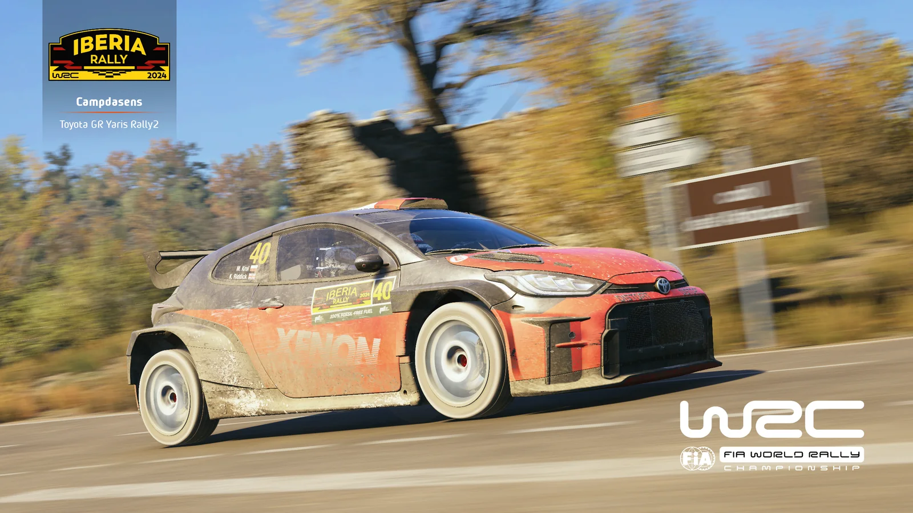
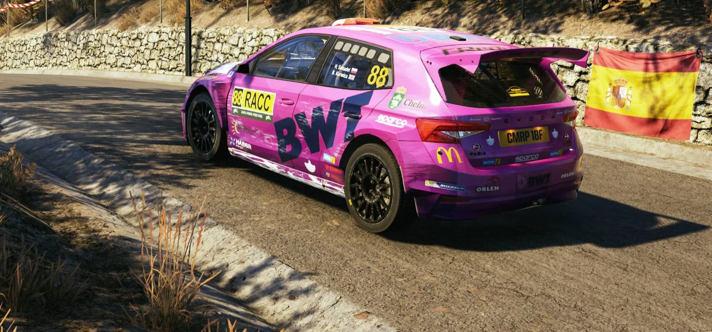

## Przesiadka na iberyjskie asfalty

Ostatni sezon ligi EA Sports WRC organizowanej przez Project Simracing przekroczył właśnie swój półmetek. Do tej pory zawodnicy, którzy postanowili pożegnać rywalizację w rajdowej grze Codemasters, mierzyli się z rajdami rozgrywanymi na nawierzchniach szutrowych. Startowali już w dwóch szybkich rundach na Łotwie i w Finlandii, a pomiędzy nimi na chwilę zwolnili tempo, aby wziąć udział w Rajdzie Akropolu.

Jak wiadomo, rajdy samochodowe to nie tylko rywalizacja na luźnych nawierzchniach, a każdy sezon musi zawierać także rundy rozgrywane na asfalcie. Na taką rundę czas przyszedł właśnie w połowie sezonu - czwartą jego rundą był Rajd Hiszpanii. Jeden z łatwiejszych asfaltowych rajdów w grze krył w sobie jednak kilka utrudnień. Kierowcy jechali głównie po szybkich i szerokich drogach, ale fragmenty poszczególnych oesów zawierały także wąskie przejazdy oraz ciasne nawroty.

## Podium: Katana, AdamRacer, Norbert

Niezależnie od nawierzchni, stopnia trudności rajdu i warunków Michał Król pokazywał do tej pory, że to on jest najlepszym kierowcą Sezonu 15. Przesiadka na asfalt i do Toyoty Yaris tylko potwierdziła niepodważalną formę Michała. Wygrał czwartą z rzędu rundę, zdobywając naturalnie dodatkowe 5 pkt za najlepszy czas na kończącym rajd Power Stage. Michał buduje tym samym swoją przewagę i pewnie kroczy w stronę odebrania nagrody dla najlepszego zawodnika.

Nieco ciekawiej sprawa wygląda w przypadku drugiego i trzeciego miejsca, którymi w każdym kolejnym rajdzie wymieniają się AdamRacer oraz Norbert.

Tym razem, odwrotnie niż w Finlandii, na drugim miejscu do mety dojechał Adam. Jego strata czasowa do Michała przekroczyła pół minuty, ale druga pozycja w rajdzie pozwala Adamowi zbliżyć się na 7 pkt do drugiego w klasyfikacji PSR1 Norberta.

Jak można wywnioskować, zawodnikiem, który uzupełnił podium iberyjskiej rundy, był Norbert. Strata między nim a Adamem na mecie była minimalna i wynosiła tylko 3 sekundy. Kolejny rajd będzie zatem następną odsłoną walki o drugie miejsce w obu indywidualnych „generalkach”.

## Od czwartego do dziesiątego miejsca

Na czwartej pozycji, z dwunastoma sekundami straty do podium, na mecie zameldował się Cheetack. Przewodzi on obecnie klasyfikacji PSR2, w której ma 7 pkt przewagi nad drugim w tej klasyfikacji DAF_TORO_ROSSO i punkt więcej nad now_ikkiem. Coraz bliżej podium pojawia się MaxxeR, piąty w Hiszpanii - to także jego najlepszy wynik w sezonie.

Formę na dość równym poziomie utrzymuje Letar, tym razem szósty. Nie jest to jego najlepszy wynik, ponieważ na Łotwie stanął na podium, ale warto odnotować, że od samego początku sezonu nie wypadł z TOP10. A skoro mowa o TOP10, to premierowy finisz w pierwszej dziesiątce zaliczył w Hiszpanii zadowolony ze swojego występu Patrickyo. Co więcej, zdobył on dodatkowy punkt za piątą pozycję na Power Stage.

Najlepszy występ w sezonie powtórzył za to Wolf, który skutecznie nawiązał w Hiszpanii do ósmego miejsca zajętego na Łotwie. Wraz z upływem sezonu swoją formę podnosi ligowy debiutant - Pabcio. Zajął w Hiszpanii dziewiątą pozycję, co jest wyraźnym progresem po dwóch miejscach w trzeciej dziesiątce oraz 17. miejscu w Finlandii. Wspomniany wcześniej now_ikk uzupełnił TOP10 Rajdu Hiszpanii, co pozwoliło mu utrzymać miejsce na podium klasyfikacji PSR2.

| Miejsce | Kierowca |
|---|---|
| 1. | Michał „Katana” Król |
| 2. | AdamRacer |
| 3. | Norbert |
| 4. | Cheetack |
| 5. | MaxxeR |
| 6. | Letar |
| 7. | Patrickyo |
| 8. | Wolf |
| 9. | Pabcio |
| 10. | now_ikk |

## Druga dziesiątka

Po dwóch występach zakończonych w topowej dziesiątce na jedenastym miejscu znalazł się tym razem daro. Od drugiej rundy sezonu równą dyspozycję utrzymuje DEVMAR, dwunasty w Hiszpanii. Kori ustabilizował swoje tempo i po jedenastej lokacie w Finlandii ukończył Rajd Hiszpanii na 13. pozycji. PawełK po raz drugi z rzędu zameldował się w najlepszej dwudziestce, a 14. miejsce to jego najlepszy dotychczas wynik.

DAF_TORO_ROSSO tym razem nie zmieścił się w najlepszej dziesiątce, ale 15. pozycja to odzwierciedlenie jego stabilnej formy. Godzio zajął 16. miejsce, czym wyrównał swój najlepszy wynik z Łotwy. JacekR uplasował się na 17. pozycji, co po 9. miejscu w Finlandii może wyglądać na obniżkę formy, ale jest to jego drugi najlepszy wynik w sezonie.

Po raz drugi na starcie i po raz drugi w TOP20 - Kasztanahh zajął w Hiszpanii 18. pozycję. Kolejny wynik w drugiej połowie drugiej dziesiątki zanotował 19. Olex. Switch wyrównał swoją dyspozycję i zajął w Hiszpanii dwudzieste miejsce.

## Klasyfikacja zespołowa

Rajd Hiszpanii to także kontynuacja walki w klasyfikacji zespołowej. Mimo zaciętej rywalizacji w dwóch ostatnich rundach między dwoma pierwszymi zespołami, czyli RacersPL oraz SRC, ci pierwsi utrzymywali przewagę w „generalce” dzięki zaliczce z Rajdu Łotwy.

| Miejsce | Zespół | Kierowcy (miejsce w rajdzie) |
|---|---|---|
| 1. | RacersPL | AdamRacer (2.), MaxxeR (5.), Thoma (28.) |
| 2. | Maczeta Racing | Cheetack (4.), Letar (6.), Godzio (16.) |
| 3. | SRC | Norbert (3.), daro (11.) |
| 4. | Almost Pro Rally Team | now_ikk (10.), PawełK (14.), RedDevil (21.) |
| 5. | Purple Sector | DEVMAR (12.), DAF_TORO_ROSSO (15.), ValtteriB (24.) |
| 6. | AdBlue Rally Team | Wolf (8.), Kaczy (23.), Shieryff (33.) |
| 7. | Lewy-3-Drzewo | Patrickyo (7.), fozzgen (36.) |
| 8. | MEGA WACKI | JacekR (17.) |
| 9. | ODCINA | Switch (20.) |
| 10. | Automobilklub Chełmski | Patryk Sahadel (26.) |
| 11. | Instinct Motorsport | Chad_MC (31.), pawlakki (34.), artur (35.) |

Asfalty przyniosły jednak dość niespodziewane wyniki. Zaczynając od zwycięzców: byli nimi zawodnicy zespołu RacersPL, którzy zdobyli 97 pkt, co pozwoliło im powiększyć przewagę nad konkurentami. AdamRacer jak zwykle zrobił to, co do niego należało, i za drugą pozycję zdobył 50 pkt. MaxxeR dzięki czwartemu czasowi na Power Stage powiększył swoją zdobycz do 39 „oczek”. 8 pkt zdobył Thoma, który finiszował na 28. pozycji.

O zwycięstwie rozstrzygnęła jednak pozycja najlepszego zawodnika z danego teamu, czyli drugiego Adama, ponieważ po raz pierwszy w historii tyle samo, 97 pkt, zdobył drugi zespół rajdu - Maczeta Racing. Najlepszym z jej zawodników był czwarty Cheetack, który zdobył 42 pkt. Niedaleko za nim wylądował Letar z 35-punktowym dorobkiem, a 16. Godzio zdobył 20 pkt. Maczeta tym samym zbliża się do drugiej pozycji w „generalce”, do której traci już tylko 13 „oczek”.

Po raz drugi w sezonie na trzecim miejscu zameldowali się kierowcy zespołu SRC. 30-punktowa strata do zwycięzców wynikała z tego, że w rajdzie punktowało tylko dwóch zawodników. Pierwszym z nich był trzeci na mecie Norbert, który zdobył 42 pkt, a 11. daro przywiózł do mety 25 punktów.

Niemal dwukrotnie lepiej niż dotychczas, jeśli chodzi o wynik punktowy, zaprezentowali się na asfalcie zawodnicy Almost Pro Rally Team. Czwarta lokata to naturalnie ich najlepszy wynik w sezonie, a do podium zabrakło niewiele, bo zaledwie 3 pkt. Wszyscy spisali się bardzo przyzwoicie: 10. now_ikk zdobył 27 pkt, 14. PawełK 22, a 21. RedDevil dopisał do zespołowego konta 15 „oczek”. Pozwala im to awansować na 5. miejsce w „generalce”.

Piąte miejsce zajął utrzymujący niezłą dyspozycję Purple Sector. Strata do podium wyniosła już 10 punktów, ale wyniki 12. DEVMAR-a (24 pkt) oraz 15. DAF-a (21 pkt) zapewniły solidną zaliczkę. Wynik uzupełnił 24. Valtteri, za co zdobył 12 pkt. „Purpurowi” utrzymują 4. pozycję w klasyfikacji sezonu, z dość bezpieczną przewagą.

Formę na asfaltach odnalazł AdBlue Rally Team. Szóste miejsce w wynikach rajdu - takie samo, jakie zespół zajmuje obecnie w „generalce” - przypadło mu głównie za sprawą bardzo dobrego wyniku Wolfa, który zdobył 31 pkt. Punktowali także 23. Kaczy (13 pkt) oraz Shieryff, który za 33. pozycję zdobył 3 „oczka”.

Na siódmym miejscu uplasował się team Lewy-3-Drzewo. Większość, bo 34 pkt, zdobył siódmy na mecie, a piąty na Power Stage Patrickyo. Tym razem towarzyszył mu także fozzgen, który za 36. miejsce zdobył 1 punkt. Takie samo miejsce jak w rajdzie zespół zajmuje także w klasyfikacji sezonu.

Na swoim standardowym poziomie zaprezentowały się w Hiszpanii MEGA WACKI. Zajęli tutaj ósme miejsce, co jest wynikiem o jedną pozycję słabszym niż w Finlandii. Honoru teamu bronił w Iberii JacekR, który jako jedyny pojawił się na mecie rajdu, zdobywając w nim 19 pkt.

Dziewiąta pozycja należała tym razem do ODCINY i podobnie jak w przypadku omawianego przed chwilą teamu, miała ona tylko jednego reprezentanta. 20. Switch zdobył w Hiszpanii 16 pkt, co pozwala ODCINIE utrzymać 9. miejsce w „generalce”.

Przedostatnie miejsce zajął Automobilklub Chełmski, reprezentowany wyłącznie przez Patryka Sahadela. Patryk ukończył Rajd Hiszpanii na 26. miejscu i zapisał na swoim, a także zespołowym koncie 10 pkt.

Na 11. pozycji zameldował się założony przez ligowego weterana, Chada_MC, Instinct Motorsport. Założyciel zdobył najwięcej punktów wśród zawodników zespołu - 5 za 31. miejsce. Niedaleko za nim, na 34. i 35. miejscu, zameldowali się pawlakki oraz artur, za co zdobyli łącznie 3 pkt. Walka o przedostatnią pozycję w klasyfikacji sezonu trwa jednak w najlepsze, bowiem dwa teamy z końca tabeli dzieli tylko 9 pkt.

## Co dalej

Zawodnicy pozostaną na asfalcie na kolejną rundę, ale będą musieli zmienić podejście na bardziej odważne. Kolejnym przystankiem ostatniego sezonu będzie szybki i mokry Rajd Europy Środkowej.
